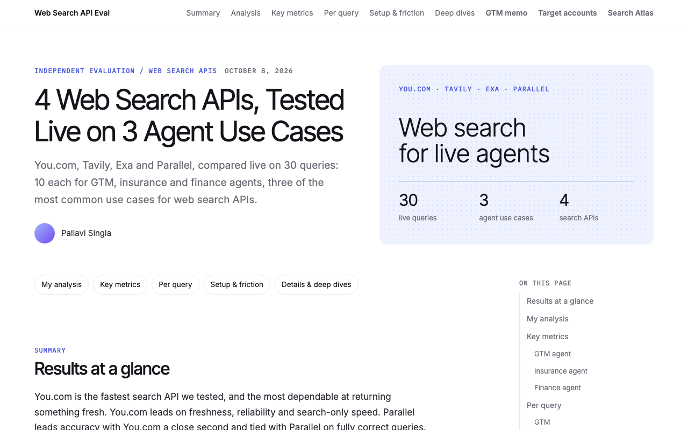
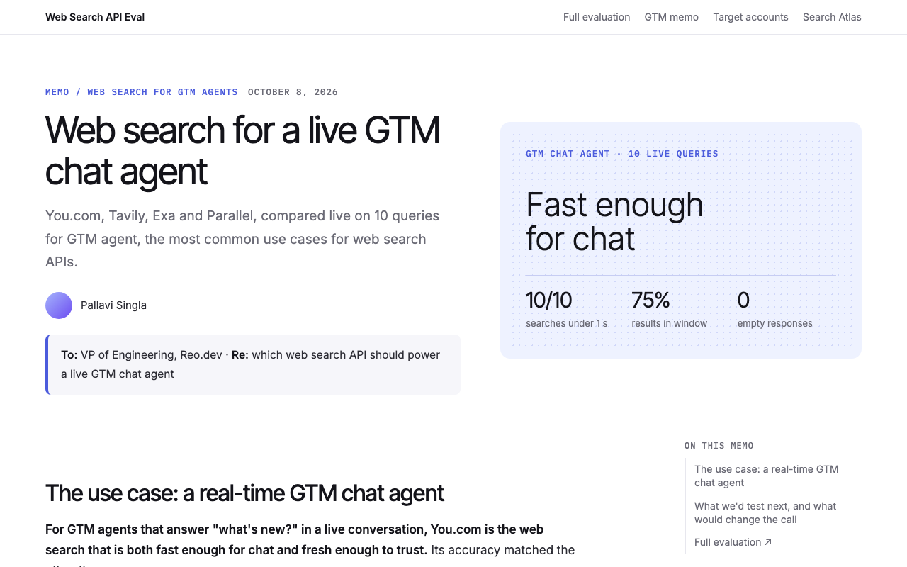
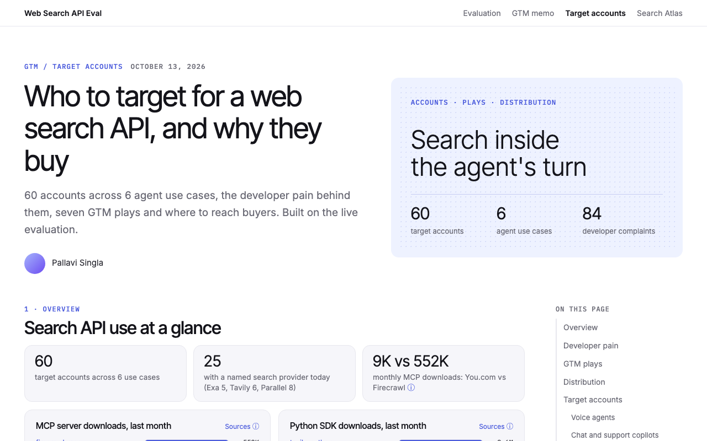
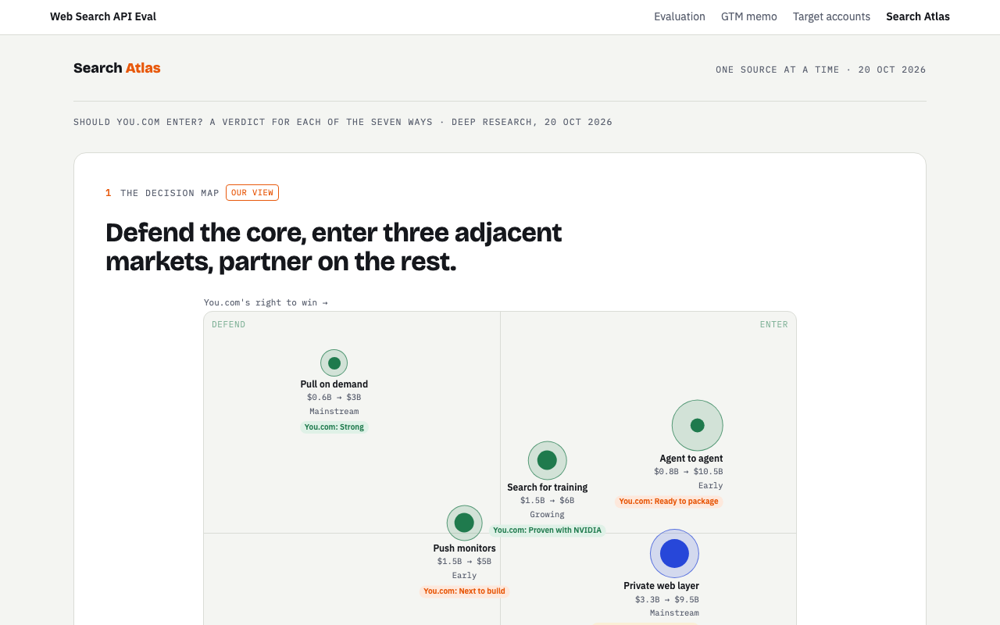
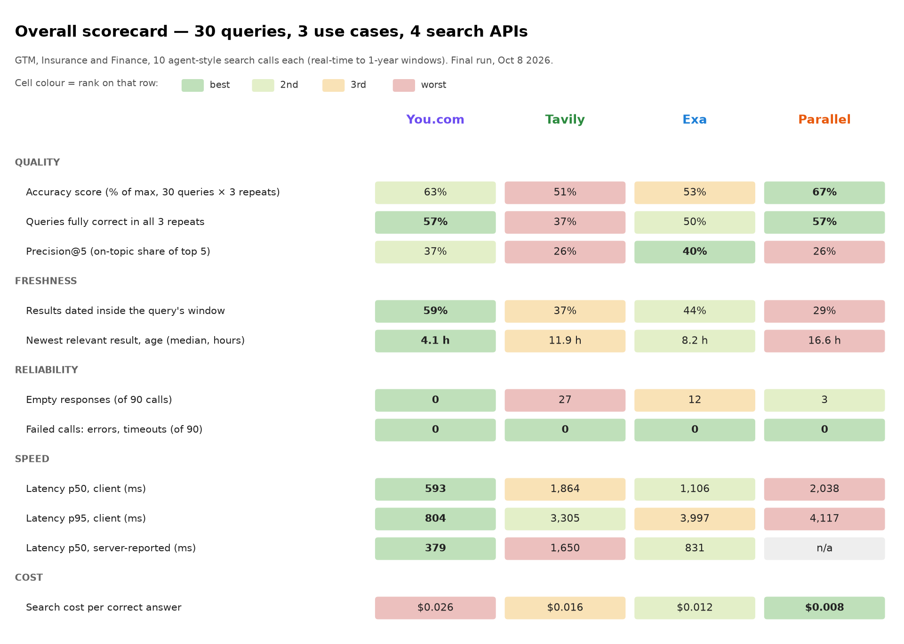
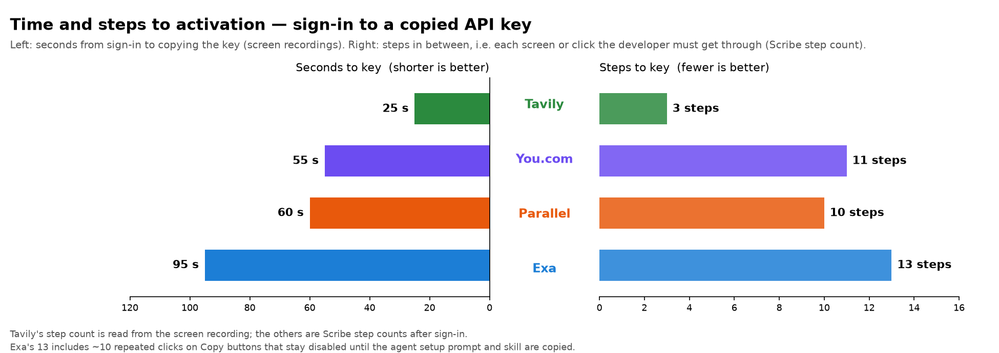

# Web Search API Eval

A live, side-by-side benchmark of four web search APIs for AI agents (**You.com, Tavily, Exa and Parallel**) on 30 agent-style queries across GTM, insurance and finance use cases, plus a buyer memo, a target-account list and a market map built on the results.

By Pallavi Singla · final run Oct 8, 2026

**Live site: https://psinglap.github.io/websearch-api-eval/**

## Contents

- [The four pages](#the-four-pages)
- [Results at a glance](#results-at-a-glance)
- [Results by use case](#results-by-use-case)
- [Methodology](#methodology)
- [Metrics and the benchmarks they follow](#metrics-and-the-benchmarks-they-follow)
- [Developer setup and friction](#developer-setup-and-friction)
- [Run it yourself](#run-it-yourself)
- [Limits](#limits)
- [Sources](#sources)
- [Repo layout](#repo-layout)

## The four pages

| | Page | What it covers |
|---|---|---|
| [](https://psinglap.github.io/websearch-api-eval/) | **[Evaluation](https://psinglap.github.io/websearch-api-eval/)** | The full benchmark: every query, answer key, what each API returned, per-use-case scorecards and the setup friction log. [PDF](pdf/web-search-api-evaluation.pdf) |
| [](https://psinglap.github.io/websearch-api-eval/memo/) | **[GTM memo](https://psinglap.github.io/websearch-api-eval/memo/)** | A one-page recommendation for an engineering lead choosing the web search API behind a live GTM chat agent. [PDF](pdf/gtm-memo.pdf) |
| [](https://psinglap.github.io/websearch-api-eval/accounts/) | **[Target accounts](https://psinglap.github.io/websearch-api-eval/accounts/)** | 60 accounts across 6 agent use cases, the developer pain behind them, seven GTM plays and where to reach buyers. Filterable. |
| [](https://psinglap.github.io/websearch-api-eval/atlas/) | **[Search Atlas](https://psinglap.github.io/websearch-api-eval/atlas/)** | The six ways AI products get web search, with market size today and in 2030, who leads each way, how the market is moving and how to win. |

## Results at a glance



| Metric (30 queries × 3 repeats = 90 calls per API) | You.com | Tavily | Exa | Parallel |
|---|---|---|---|---|
| Accuracy score (% of max) | 63% | 51% | 53% | **67%** |
| Queries fully correct in all 3 repeats | **57%** | 37% | 50% | **57%** |
| Precision@5 (on-topic share of top 5) | 37% | 26% | **40%** | 26% |
| Results dated inside the query's window | **59%** | 37% | 44% | 29% |
| Newest relevant result, median age | **4.1 h** | 11.9 h | 8.2 h | 16.6 h |
| Empty responses (of 90) | **0** | 27 | 12 | 3 |
| Failed calls: errors, timeouts (of 90) | **0** | **0** | **0** | **0** |
| Latency p50 / p95, client (ms) | **593 / 804** | 1,864 / 3,305 | 1,106 / 3,997 | 2,038 / 4,117 |
| Latency p50, server-reported (ms) | **379** | 1,650 | 831 | n/a |
| Search cost per correct answer | $0.026 | $0.016 | $0.012 | **$0.008** |

**Headline:** You.com is the fastest API tested and the most dependable at returning something fresh: it leads on freshness, reliability and search-only speed. Parallel leads accuracy, with You.com a close second and tied on fully correct queries. Exa returns the most on-topic top 5; Parallel is cheapest per correct answer.

**Which API fits which agent (from this test):**

| If your agent… | Pick | Why |
|---|---|---|
| Answers inside a live turn (voice, chat, alerts) | **You.com** | Fastest at p50 and p95, freshest results, never returned empty |
| Does deep research where seconds don't matter | **Parallel** | Highest finance accuracy; found the release pages and jobless-claims report others missed |
| Needs the most on-topic top 5 for semantic or long-tail queries | **Exa** | Best precision@5 in GTM and insurance; best insurance accuracy |
| Looks up docs or how-to answers | **Tavily** | Best GTM accuracy; correct on the config-docs query |

## Results by use case

Accuracy score (% of max) and search-only client latency p50:

| Use case | Agent job | You.com | Tavily | Exa | Parallel |
|---|---|---|---|---|---|
| **GTM** | Find fresh developer and company buying signals (issues, releases, funding, incidents) | 45% · 627 ms | 47% · 2,843 ms | 45% · 1,102 ms | 45% · 2,268 ms |
| **Insurance** | Voice and claims agent that needs live catastrophe status mid-call (500 ms budget) | 65% · 589 ms | 67% · 1,864 ms | **75%** · 1,093 ms | 67% · 2,038 ms |
| **Finance** | Analyst agent that needs exact, current numbers with primary-source citations | 80% · 592 ms | 40% · 1,642 ms | 40% · 1,106 ms | **88%** · 1,972 ms |

You.com answered all 30 search-only calls in under 1 second; no other provider managed more than 3 of 10 in any use case. Full scorecards, per-query grids and what each API returned are on the [Evaluation page](https://psinglap.github.io/websearch-api-eval/).

## Methodology

**Queries.** 30 queries, 10 per use case (GTM G1–G10, Insurance I1–I10, Finance F1–F10). Each is written the way an AI agent calls web search:

| Field | Example (G3) |
|---|---|
| Upstream task given to the agent | "Any new mentions of Apache Iggy in the last day?" |
| Search call the agent sends | `"Apache Iggy"` |
| Parameters | window 24h |
| What the agent needs back | Every mention (repo, blog, forum) in 24h, with date, or "none" |
| Answer key | Captured at run time, with source link and Wayback Machine snapshot |

Every use case has at least 4 real-time queries; the rest use 24-hour, 48-hour, 7-day or 1-year windows. Some queries expect "none" as the right answer, to test whether an API presents stale pages as current.

**Same request for everyone.** Each provider gets the exact query string with the same parameters: 10 results, full page content where supported, the freshness window, and domain filters where supported.

**Runs.** Searches ran in [promptfoo](https://www.promptfoo.dev/) with Python providers: 3 runs per query, 90 calls per API. Latency is client-side wall-clock time around the HTTP request only, on a persistent connection after one discarded warm-up call; provider-reported server latency is recorded alongside. Search-only speed comes from a run of first-time queries sent one at a time, so caching doesn't flatter repeats.

**Grading.** Answers were written and graded from each provider's saved results (top 5), using the published SimpleQA grader rubric for accuracy and FreshQA strict rules for "none" answers and stale results. Answer keys were captured live at run time and archived to the Wayback Machine.

**Evidence kept per call.** Raw provider JSON, result dates and how each date was found, relevance labels, grader output, and an automatic log of every API anomaly.

## Metrics and the benchmarks they follow

| # | Metric | How it's measured | Standard it follows |
|---|---|---|---|
| 1 | Latency p50 / p95, % within budget | Client wall-clock per call; budget 3 s (GTM, finance), 500 ms (insurance) | [Artificial Analysis search methodology](https://artificialanalysis.ai/methodology/search-api) |
| 2 | Accuracy (0–2) | Correct = 2, incorrect or not attempted = 0; a partly right list = 1 | [SimpleQA](https://arxiv.org/html/2411.04368) grader template, verbatim |
| 3 | Correct "none" | Says "none" when true without citing stale pages as current; never claims "none" when an answer exists | [FreshQA](https://arxiv.org/pdf/2310.03214) strict rules |
| 4 | Freshness: % in window | Share of returned results dated inside the query's window | Provider dates + [htmldate](https://htmldate.readthedocs.io/en/latest/evaluation.html) |
| 5 | Freshness: newest relevant result | Age in hours of the newest relevant result at run time | FreshQA |
| 6 | Precision@5 | Share of the top 5 judged relevant, time window included | TREC-style binary relevance |
| 7 | Content in one call | Search response itself includes usable page text, no second fetch | Measured directly |
| 8 | Token efficiency | Tokens in the top 5 results, per query and per correct answer | tiktoken (cl100k) |
| 9 | Cost per correct answer | Search list price × calls ÷ correct answers | Vendor list prices, dated |
| 10 | Reliability | Errors, timeouts and empty result lists per 90 calls | promptfoo |

With 10 queries per use case, results are reported per query ("won 7 of 10") rather than as percentage-point margins.

## Developer setup and friction

Each signup was screen-recorded from sign-in to a copied API key, then to a first successful call.



| | Tavily | You.com | Parallel | Exa |
|---|---|---|---|---|
| Seconds from sign-in to copied key | **25 s** | 55 s | 60 s | 95 s |
| Steps (screens or clicks) | **3** | 11 | 10 | 13 |
| First API call | 1.28 s, HTTP 200 | **0.65 s**, HTTP 200 | 3.57 s, HTTP 200 | 3.20 s, HTTP 200 |

Every provider worked on the first call. The full timed friction log is on the [Evaluation page](https://psinglap.github.io/websearch-api-eval/).

## Run it yourself

The full test harness is in [`eval/`](eval/): promptfoo configs, Python providers for each API, the assertions behind every metric, ground-truth pullers, answer keys and grades. Metric definitions are in [`eval/METRICS.md`](eval/METRICS.md) and the query set is in [`reports/Agent queries.md`](reports/Agent%20queries.md).

### The 30 questions

Every API gets the same search call and parameters. The answer keys (expected answer, source link, Wayback snapshot) are in [`eval/answer_keys.csv`](eval/answer_keys.csv), and the test files built from these questions are in [`eval/tests/`](eval/tests/).

<details><summary><b>GTM agent (developer and company buying signals)</b>: 10 questions</summary>

| ID | What the agent is asked | Search call sent to each API | Parameters | Freshness |
|---|---|---|---|---|
| G1 | Find developers hitting Kafka latency problems right now | `kafka consumer lag high latency issue` | window last ~6 h (tightest available), domains: github.com | real-time |
| G2 | Account signal: anything new at Confluent today? | `Confluent news` | window 24h | real-time |
| G3 | Any new mentions of Apache Iggy in the last day? | `"Apache Iggy"` | window 24h | real-time |
| G4 | Draft a note on Apache Iggy's latest release for a prospect | `Apache Iggy release notes` | window 7 days, domains: github.com, iggy.apache.org | week |
| G5 | Coding agent fixing a consumer-lag bug needs the official tuning guidance | `kafka consumer lag max.poll.records fetch.min.bytes` | window 1 year, domains: kafka.apache.org, docs.confluent.io | year |
| G6 | Competitive brief: what's the latest NATS server release? | `NATS server release` | window 7 days, domains: github.com | week |
| G7 | Is Confluent Cloud having an incident right now? (outage = switching trigger) | `Confluent Cloud incident` | window 24h, domains: status.confluent.cloud | real-time |
| G8 | Which AI-agent / data-infra startups just raised money? | `AI agent infrastructure startup funding round` | window 48h | 48h |
| G9 | Find this week's content about memory/event logs for AI agents | `durable event log memory for AI agents` | window 7 days | week |
| G10 | Competitive brief: published Redpanda vs Kafka latency benchmarks | `Redpanda vs Kafka p99 latency benchmark` | window 1 year | year |

</details>

<details><summary><b>Insurance agent (voice and claims, live catastrophe status)</b>: 10 questions</summary>

| ID | What the agent is asked | Search call sent to each API | Parameters | Freshness |
|---|---|---|---|---|
| I1 | Caller wants a new Florida homeowners policy | `Citizens Property Insurance binding suspension Florida` | window 24h, domains: citizensfla.com | real-time |
| I2 | Caller in Pensacola asks if the storm is coming | `Hurricane Isaias latest advisory NHC` | window 24h | real-time |
| I3 | Agent must check warnings for the policy's county before binding | `hurricane warning Escambia County Florida active` | window 24h | real-time |
| I4 | Claims agent validating a wind-damage report in progress | `Pensacola weather wind speed` | window 24h | real-time |
| I5 | Policyholder asks if they must evacuate | `Baldwin County Alabama evacuation order Isaias` | window 24h | real-time |
| I6 | Claims ops checks whether federal aid applies | `FEMA disaster declaration Hurricane Isaias 2026` | window 48h | 48h |
| I7 | Compliance agent checks for new regulator orders | `Florida OIR OR Alabama DOI emergency order Isaias insurance` | window 48h | 48h |
| I8 | Underwriting checks which states declared emergencies | `governor state of emergency Hurricane Isaias` | window 7 days | week |
| I9 | Claims agent validating a Texas hail claim | `Texas hail storm reports` | window 24h, domains: spc.noaa.gov | 24h |
| I10 | Caller asks whether their 2024 Toyota RAV4 has an open recall | `NHTSA recall 2024 Toyota RAV4` | window 1 year, domains: nhtsa.gov | year |

</details>

<details><summary><b>Finance agent (analyst Q&A with primary sources)</b>: 10 questions</summary>

| ID | What the agent is asked | Search call sent to each API | Parameters | Freshness |
|---|---|---|---|---|
| F1 | Where is NVIDIA trading? | `NVDA stock price` | window 24h | real-time |
| F2 | Where's the 10-year? | `US 10-year Treasury yield` | window 24h | real-time |
| F3 | Bitcoin price? | `BTC USD price` | window 24h | real-time |
| F4 | How's oil moving today? | `WTI crude oil price` | window 24h | real-time |
| F5 | What did jobless claims print? | `initial jobless claims weekly report` | window 24h, domains: dol.gov | real-time |
| F6 | Summarize the latest Fed minutes | `FOMC minutes` | window 7 days, domains: federalreserve.gov | week |
| F7 | List $1B+ M&A deals announced in the last two days | `definitive agreement to acquire billion` | window 48h | 48h |
| F8 | Monitoring account Stryker: what did its latest 8-K report? | `Stryker 8-K item 5.02` | window 7 days, domains: sec.gov | week |
| F9 | Analyst asks about the Chilwa Minerals listing | `Chilwa Minerals IPO price per share` | window 7 days | week |
| F10 | When does JPMorgan report Q3? | `JPMorgan third quarter 2026 earnings release date` | window 7 days | week (upcoming) |

</details>

### Steps

```bash
cd eval
./run.sh setup --playwright   # Python venv + requirements, promptfoo 0.124.0, Chromium
cp .env.example .env          # add your own API keys; .env is git-ignored
./run.sh smoke                # one call per provider to check keys
./run.sh run gtm              # also: insurance, finance
./run.sh analyze              # scorecards and charts into eval/out/
```

You need your own keys for each search API (`YDC_API_KEY`, `TAVILY_API_KEY`, `EXA_API_KEY`, `PARALLEL_API_KEY`, plus `FIRECRAWL_API_KEY` and `LINKUP_API_KEY` for the six-provider configs) and an `SEC_USER_AGENT` with your contact email for SEC EDGAR. No keys are stored in this repo. Full steps are in [`eval/README.md`](eval/README.md).

**Included for audit:** answer keys with source and Wayback links (`eval/answer_keys.csv`), per-query grades (`eval/grading/`), raw ground-truth snapshots pulled at run time (`eval/ground_truth/raw/`), the evidence log (`eval/evidence/evidence_log.csv`) and the friction log (`eval/friction_log.csv`). Raw provider responses are not included because of their size.

## Limits

- 10 queries per use case is a focused test, not a leaderboard; differences of a query or two are within noise.
- Results reflect one run day (Oct 8, 2026); freshness and accuracy depend on what was published that day.
- Prices are vendor list prices as of the run date; cost covers search only, not the answering model.

## Sources

- **Harnesses and grading:** [promptfoo](https://www.promptfoo.dev/) · [You.com web-search-api-evals](https://github.com/youdotcom-oss/web-search-api-evals) · [Tavily tavily-search-evals](https://github.com/tavily-ai/tavily-search-evals) · [SimpleQA](https://arxiv.org/html/2411.04368) · [FreshLLMs / FreshQA](https://arxiv.org/pdf/2310.03214) · [htmldate evaluation](https://htmldate.readthedocs.io/en/latest/evaluation.html) · [Wayback Machine Save Page Now](https://web.archive.org/save)
- **Third-party benchmarks for comparison:** [Artificial Analysis Search Index](https://artificialanalysis.ai/agents/search-api) · [Openbenchmarks web search](https://openbenchmarks.com/web-search)
- Market and customer facts on the Target accounts and Search Atlas pages come from public sources (vendor case studies, docs, pricing pages, press) and are linked on each page.

## Repo layout

| Path | Contents |
|---|---|
| `index.html` | Evaluation page |
| `memo/` | GTM memo |
| `accounts/` | Target accounts |
| `atlas/` | Search Atlas |
| `img/` | Scorecards, per-query grids, activation charts and page screenshots |
| `pdf/` | PDF versions of the evaluation and memo |
| `eval/` | Test harness: configs, providers, metric assertions, answer keys, grades, ground truth |
| `reports/` | The 30 agent queries |
